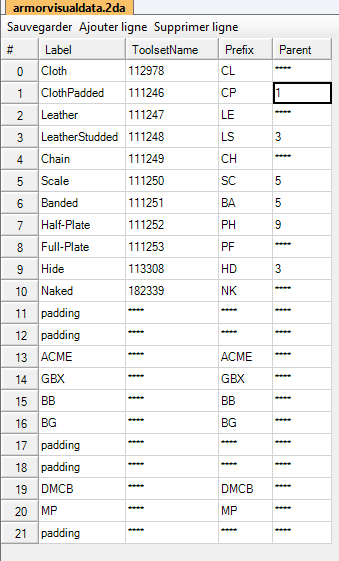
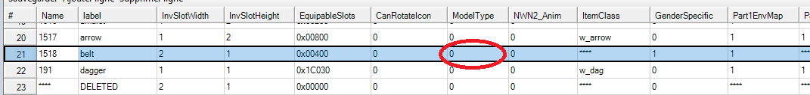
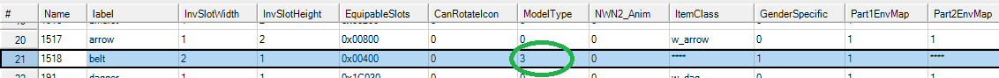

---
pdf_options:
  format: A4
  margin: 18mm 16mm 20mm 16mm
  outline: true
  displayHeaderFooter: true
  headerTemplate: "<span></span>"
  footerTemplate: "<div style='width:100%; font-size:9px; font-family:Arial; color:#666; text-align:center;'>xp_aspectManager – <span class='pageNumber'></span> / <span class='totalPages'></span></div>"
---

<div class="cover-title">
<div class="cover-heading">xp_aspectManager</div>
<div class="cover-version">V1.5.7 – 2026-10-16 by Septirage</div>
</div>

<div class="toc">

<div class="toc-title">Table of contents</div>

<!-- TOC -->

</div>

<div class="pagebreak"></div>

# Guide for Admin

## Requirements

To use the xp_aspectManager plugin you will need:

- [Nwnx4](https://github.com/nwn2dev/nwnx4)
- xp_bugfix (included in the nwnx4 package)

## Installation of xp_aspectManager

1. Put `xp_aspectManager.dll`, `xp_aspectManager.ini` and `listeHakZip.ini` in your nwnx4 folder.

```text
nwnx4/
├── listeHakZip.ini
├── xp_aspectManager.dll
└── xp_aspectManager.ini
```

2. Add the 6 `nwnx_aspectManager*.nss` files to your module (or import them with `xp_aspectManager.erf`). Those files contain all the functions you can use. See [NwnScript Functions Overview](#nwnscript-functions-overview) below.

Have a look at our website (<https://septirage.com/nwn2/d/Plugins?id=xpAM>) for an overview of the plugin's usefulness.

## Configuration of xp_aspectManager

xp_aspectManager uses two ini files:

- `xp_aspectManager.ini`: the main configuration file.
- `listeHakZip.ini`: the list of the zip/hak files to scan (only used by the appearance list system).

### xp_aspectManager.ini

<div class="options">

| Option | Default | Description |
|---|---|---|
| `loglevel` | 3 | Log verbosity: 0 none, 1 error, 2 warning, 3 info, 4 debug, 5 trace. |
| `FixBelt` | 0 | Set to 1 to fix the visibility bug of the belt (also needs a change in `baseitems.2da`, see [BeltFix](#beltfix)). |
| `PatchDoorScale` | 1 | Set to 1 to fix the object scale functions on doors. |
| `PatchSetIcon` | 1 | Set to 1 to refresh the icon of an item for the players when `SetIcon` is used. |
| `PatchItemPropertyFct` | 1 | Set to 1 to enable the new ItemProperty functions (`GetSpecificItemProperty_xpAM`, `AddItemProperty_xpAM`, ...). |
| `UseAccountNameForOOCMsg` | 0 | Set to 1 to use the player account name instead of the character name for all OOC messages. |
| `KeepNameForViewer` | 1 | Set to 1 to keep the names given by `SetCreatureNameForViewer_xpAM` until `ClearCreatureNameForViewer_xpAM` or `ForgetCreatureNames_xpAM` is called. If 0, the name is only sent once. |
| `UseListSystem` | 1 | Set to 1 to use the whole appearance list system (scan and management), 0 otherwise. The options below are only used if `UseListSystem = 1`. |
| `ScanFiles` | 1 | Choose the scan behaviour:<br>**0**: no scan. If you already have a save file, it is loaded.<br>**1**: always scan.<br>**2**: "intelligent scan". Scans only if a file named `AspectManagerScan` is present in the plugin directory, then deletes it. Basic usage: set it to 2 and create an `AspectManagerScan` file each time you update your haks, so you avoid the scan time at each server launch. |
| `PathToListFile` | `listeHakZip.ini` | Name/path of the list file. |
| `PathToSaveFile` | `ArmorVisualSaveFile` | Name of the file that saves your appearance classification. |
| `defaultName` | — | Category name given to the new appearances found when a save file already exists. |
| `ArmorVisualMaxNumber` | 10 | Last index of the list of armor visual types. This option and the numbered lines that follow it define the types and their names, see [ArmorVisualData](#armorvisualdata). |

</div>

#### ArmorVisualData

`ArmorVisualMaxNumber` is the last index of your list. The list then gives, for each index, the prefix of the armor visual type. It must be built from your `armorvisualdata.2DA` file and must contain its whole content.

For this `armorvisualdata.2DA`:



The options must be set to:

```ini
ArmorVisualMaxNumber = 10
0 = CL
1 = CP
2 = LE
3 = LS
4 = CH
5 = SC
6 = BA
7 = PH
8 = PF
9 = HD
10 = NK
```

If an index has no prefix, simply skip it and continue with the next number.

If you want more user-friendly names, add `@Name` at the end of a line. Several prefixes can share the same name, which merges them into one category.

Example, for a 2DA that also contains the ACME, GBX, BB, BG, DMCB and MP models (rows 13 to 20):

```ini
ArmorVisualMaxNumber = 20
13 = ACME@More
14 = GBX@More
15 = BB@More
16 = BG@Other
19 = DMCB
20 = MP@Other
```

With that configuration, the ACME, GBX and BB models are put in the "More" category, BG and MP in the "Other" category, and DMCB stays DMCB.

### listeHakZip.ini

Used by the appearance list management system.

- Be sure that the paths to the base game zip files are correct.
- Add the path of every hak file that has Armor / Weapon / Head / Hair models in it.
- A line starting with `#` is a comment.

Example:

```text
C:\Program Files\Atari\Neverwinter Nights 2\Data\NWN2_Models.zip
C:\Program Files\Atari\Neverwinter Nights 2\Data\NWN2_Models_v103x1.zip
C:\Program Files\Atari\Neverwinter Nights 2\Data\NWN2_Models_X2_v121.zip

C:\Users\You\Documents\Neverwinter Nights 2\hak\MyArmors1.hak
C:\Users\You\Documents\Neverwinter Nights 2\hak\MyWeapons.hak
C:\Users\You\Documents\Neverwinter Nights 2\hak\MyHeads.hak
```

### BeltFix

If you want a player to see their belt, you also need to update your `baseitems.2DA` file.

On the `belt` line, set the `ModelType` column to `3`.

Before:



After:



## NwnScript Functions Overview

Due to the amount of "new functions" added, xp_aspectManager comes with 6 nss files:

| File | Content |
|---|---|
| `nwnx_aspectManager.nss` | Generic functions. |
| `nwnx_aspectManager_area.nss` | Functions specialized in areas. |
| `nwnx_aspectManager_creature.nss` | Functions specialized in creatures. |
| `nwnx_aspectManager_item.nss` | Functions specialized in items. |
| `nwnx_aspectManager_light.nss` | Functions specialized in lights. |
| `nwnx_aspectManager_list.nss` | Everything needed to access and manage the appearance lists. Functions are prefixed with `XPAspMan_`. |

The functions of all the other files have the suffix `_xpAM`.

The full reference of all those functions is in a separate document, **xp_aspectManager functions Guide**, distributed with the plugin. Each function is also documented in the `.nss` files themselves.

<div class="pagebreak"></div>

<!-- INCLUDE CHANGELOG.md -->
